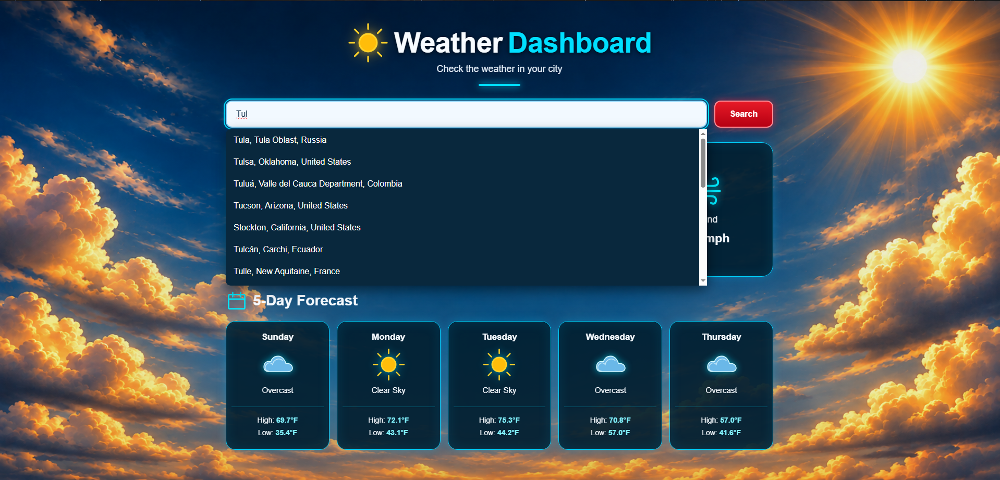
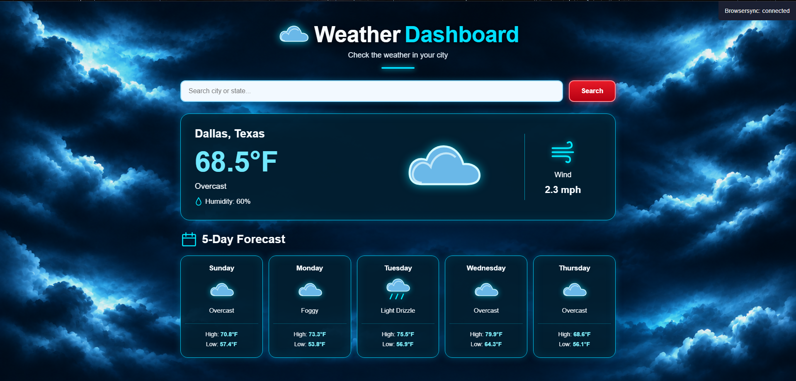
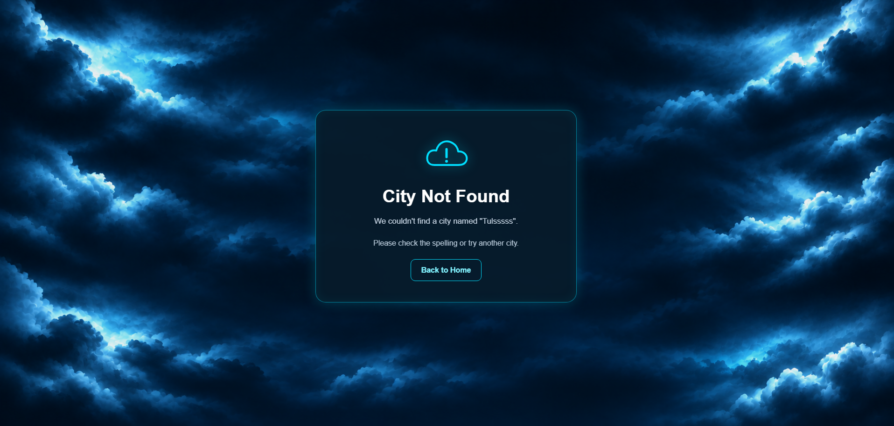
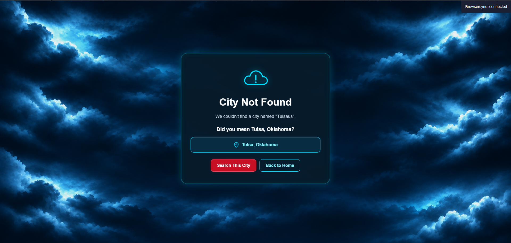
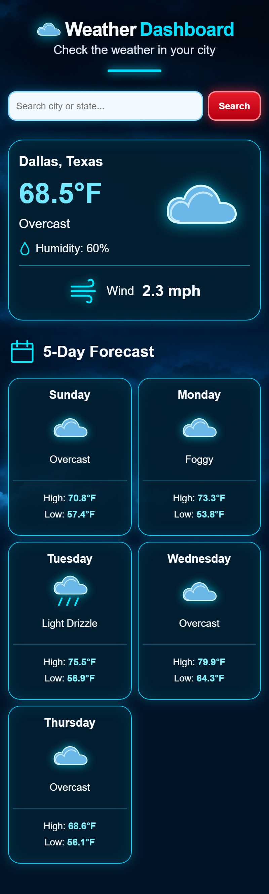

# Python Weather Dashboard

A responsive weather dashboard built with Python, Flask, HTML, CSS, and JavaScript. The application retrieves real-time weather conditions and a five-day forecast using the Open-Meteo API.

The dashboard features dynamic weather-themed backgrounds, interactive city search, custom weather icons, and a responsive interface designed for desktop, tablet, and mobile devices.

## Live Demo

Try the Weather Dashboard online:

[Launch Weather Dashboard](https://weather-dashboard-n5no.onrender.com)

## Features

- **Current Weather:** Displays temperature, weather conditions, humidity, and wind speed.
- **5-Day Forecast:** Shows daily weather conditions and high and low temperatures.
- **City Autocomplete:** Search for cities and states with interactive location suggestions.
- **Accurate Locations:** Uses latitude and longitude coordinates to retrieve weather for the selected city.
- **Dynamic Backgrounds:** Automatically switches between sunny, cloudy, rainy, and snowy backgrounds based on current weather conditions.
- **Custom Weather Icons:** Displays SVG icons for different weather conditions.
- **Error Handling:** Provides a custom error page for invalid locations, including spelling suggestions when available.
- **Responsive Design:** Supports desktop, tablet, and mobile screen sizes.

## Technologies Used

| Technology | Purpose |
|---|---|
| Python | Backend application logic |
| Flask | Web framework and routing |
| HTML5 | Page structure |
| CSS3 | Styling, responsive layouts, and weather themes |
| JavaScript | Interactive city search and autocomplete |
| Open-Meteo API | Weather forecasts and geocoding |
| Requests | HTTP requests to external APIs |
| Jinja2 | Dynamic HTML templates |

## Screenshots

### Weather Dashboard


### Weather Dashboard Showing Autocomplete




### Additional Weather Conditions



### City Not Found Page



### City Not Found With MissSpelling Page



### Mobile View



## Project Structure

```text
Weather Dashboard/
├── app.py
├── weather.py
├── README.md
├── requirements.txt
├── .gitignore
├── templates/
│   ├── index.html
│   └── error.html
├── static/
│   ├── css/
│   │   └── style.css
│   └── images/
│       ├── sunny.png
│       ├── cloudy.png
│       ├── rainy.png
│       └── snowy.png
└── screenshots/
    └── Project screenshots
```

## Installation

### 1. Clone the Repository

```bash
git clone https://github.com/Zacharycoo/weather-dashboard.git
cd weather-dashboard
```

GitHub username Zacharycoo.

### 2. Install Dependencies

Make sure Python is installed, then run:

```bash
pip install -r requirements.txt
```

### 3. Run the Application

```bash
python app.py
```

### 4. Open the Dashboard

Visit:

http://127.0.0.1:5000

## How It Works

1. The user enters a city name or selects a location from autocomplete suggestions.
2. The application obtains the selected location's latitude and longitude.
3. Flask requests weather information from the Open-Meteo API.
4. The application processes current conditions and forecast data.
5. Jinja2 renders the weather information into the dashboard.
6. The interface displays weather-specific icons and automatically selects the appropriate background.

If a location cannot be found, the application displays a custom error page with a possible spelling correction when one is available.

## API

This project uses the free [Open-Meteo API](https://open-meteo.com/) for weather data and location lookup.

## Future Improvements

- Add additional weather information, such as sunrise and sunset times.
- Allow users to save favorite cities.
- Add an hourly weather forecast.
- Provide temperature unit switching between Fahrenheit and Celsius.

## Author

**Zachary McCarrell**

Computer Science Student | Aspiring Software Developer

Built as a software development portfolio project.
